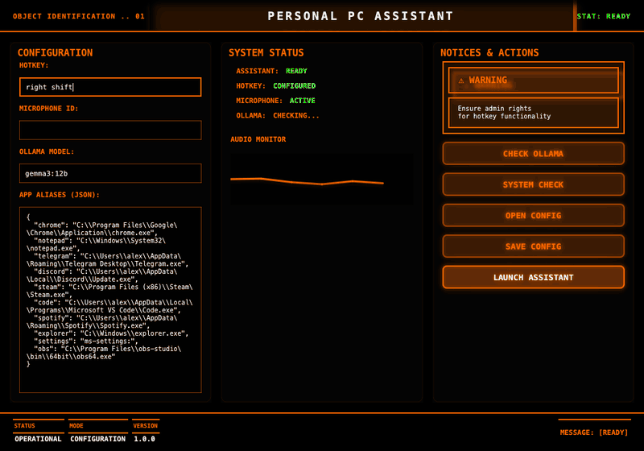
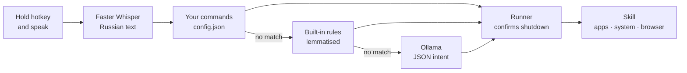
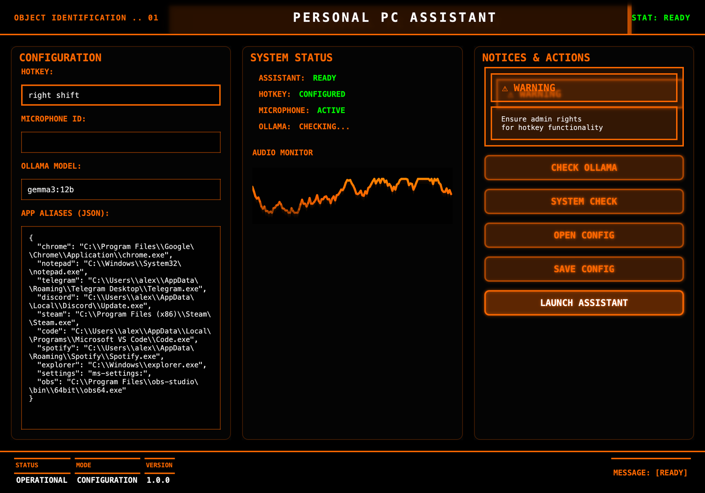

<div align="center">



# Personal PC Assistant

**A local voice assistant for Windows. Hold a key, say what you want, and your PC does it. Speech recognition and intent detection run on your machine, with no cloud APIs.**

[](https://github.com/Bogdusik/Personal-PC-Assistant/actions/workflows/lint.yml)
[](LICENSE)


[How it works](#how-it-works) · [What you can say](#what-you-can-say) · [Setup](#setup) · [Custom commands](#teach-it-your-own-commands)

</div>

## How it works

Hold **Right Shift** (configurable), speak, release. The audio never leaves your computer.



1. **Transcribe.** Faster Whisper turns the recording into Russian text, using the small `tiny` model first and `base` if that fails to load.
2. **Understand.** Your own commands from `config.json` are tried first, then built-in rules that work on the lemmatised phrase (so "открой хром" and "запусти хром" mean the same). Only phrases no rule recognises go to your local Ollama model, which must answer with a validated JSON intent.
3. **Act.** The runner executes the matching skill. Shutdown and restart ask for a spoken *yes* or *no* first and cancel themselves after 25 seconds.

## The control panel



The PyQt6 panel (`main_gui.py`) edits the hotkey, microphone, model and app aliases, checks that Ollama and the system are ready, and launches the assistant. It uses a neon-orange sci-fi theme with an animated waveform.

> The screenshot is the real window rendered with a sample config.

## What you can say

Voice commands are in Russian. These are the results of the built-in rules:

| You say | Means | Intent |
|---|---|---|
| «открой хром» | open Chrome | `open_app` |
| «закрыть хром» | close Chrome | `close_app` |
| «сверни спотифай» | minimise Spotify | `minimize_app` |
| «загугли погода в лондоне» | search the web | `open_browser_search` |
| «установить громкость 40» | set volume to 40% | `system_volume` |
| «яркость 70» | set brightness to 70% | `brightness_set` |
| «сделать скриншот» | take a screenshot | `screenshot` |
| «включить вайфай» | toggle Wi-Fi | `wifi_toggle` |
| «заблокировать компьютер» | lock the PC | `system_lock` |
| «режим сна» | sleep | `system_sleep` |
| «выключить компьютер» | shut down (asks to confirm) | `system_shutdown` |
| «перезагрузить систему» | restart (asks to confirm) | `system_restart` |
| «скопировать в буфер привет мир» | copy "привет мир" | `clipboard_copy` |
| «вставить из буфера» | read the clipboard | `clipboard_paste` |
| «статус» | system status | `system_status` |

Phrases like «найди discord» search your installed programs. Anything no rule recognises goes to Ollama, which can also open websites.

## Teach it your own commands

Say «новая команда» (or press **Ctrl+4** while the assistant is running) and the assistant walks you through a new trigger. Commands are saved to `config.json` straight away, and you can also write them by hand:

```json
{
  "custom_commands": [
    {
      "match_type": "equals",
      "pattern": "рабочее место",
      "intent": "open_app",
      "args": { "alias": "code" },
      "speak": "Открываю редактор."
    }
  ]
}
```

`match_type` is `equals`, `startswith`, `contains` or `regex`. A regex that takes longer than half a second is skipped, so a bad pattern cannot freeze the assistant.

## Setup

**Requirements:** Windows 10 or 11, Python 3.10 or newer, a microphone and [Ollama](https://ollama.ai).

```bat
git clone https://github.com/Bogdusik/Personal-PC-Assistant.git
cd Personal-PC-Assistant
setup.bat
ollama pull gemma3:12b
python main_gui.py
```

`setup.bat` checks for admin rights, copies `config.example.json` to `config.json` and installs the dependencies. **Run the assistant as Administrator**: Windows only lets elevated programs listen for the global hotkey.

`gemma3:12b` is a large model. On a weaker machine pick a smaller one with the `ollama_model` setting or the `OLLAMA_MODEL` variable.

### Configuration

Edit `config.json`, or use the control panel:

| Key | Default | Meaning |
|---|---|---|
| `hotkey` | `"right shift"` | Key to hold while speaking |
| `mic_device` | `null` | Microphone index, or `null` for the default |
| `ollama_model` | `"gemma3:12b"` | Model used when no rule matches |
| `app_aliases` | sample list | Short names mapped to `.exe` paths |
| `custom_commands` | `[]` | Your own voice commands |

`OLLAMA_BASE_URL` (default `http://localhost:11434`) and `OLLAMA_MODEL` override the server and the model.

### Two ways to run it

| File | Use when |
|---|---|
| `main_gui.py` | Daily use: control panel with visual feedback |
| `main_fast.py` | Debugging and scripting: console only, lighter start |

## Project structure

```
Personal-PC-Assistant/
├── main_gui.py / main_fast.py   # Entry points
├── assistant/
│   ├── core/                    # Error types and shared state
│   ├── nlu/                     # Normaliser, rule engine, Ollama client
│   ├── skills/                  # Apps, system control, browser, clipboard, registry
│   ├── asr.py                   # Faster Whisper transcription
│   ├── recorder.py              # Push-to-talk capture
│   └── runner.py                # Skill dispatch and confirmation flow
├── tests/                       # Rule engine, config and skill tests
└── config.example.json
```

## Development

The rule engine and its tests need no Windows APIs and no Ollama:

```bash
pip install pytest pymorphy3 pymorphy3-dicts-ru regex requests psutil
pytest tests/ -v

pip install ruff mypy
ruff check . --select E,F,W,I --ignore E501
mypy assistant --ignore-missing-imports --no-strict-optional
```

CI runs the tests on Python 3.10, 3.11 and 3.12, and lints and type-checks on Windows.

## Limits

- Windows only: volume, brightness, Wi-Fi and window control use `pywin32`, `pycaw` and WMI.
- Speech is recognised as Russian, and the built-in rules and the Ollama prompt are in Russian.
- Only shutdown and restart ask for confirmation. Everything else runs as soon as it is understood.
- The audio monitor in the control panel is an animation; it does not read the microphone level.

## What I learned

- **Local speech pipeline:** push-to-talk capture, Faster Whisper on CPU and a rule engine in front of an LLM, so common commands are instant and the model only handles the rest.
- **Rules versus lemmas:** the rules were written in inflected forms but matched against lemmatised text, so several commands silently never fired until the tests ran them.
- **Untrusted patterns:** user-defined regexes need a timeout; a nested quantifier froze the assistant for 80 seconds.
- **Desktop automation:** global hotkeys, UAC and what breaks across Python versions when a dependency is unmaintained.

## License

[MIT](LICENSE)
